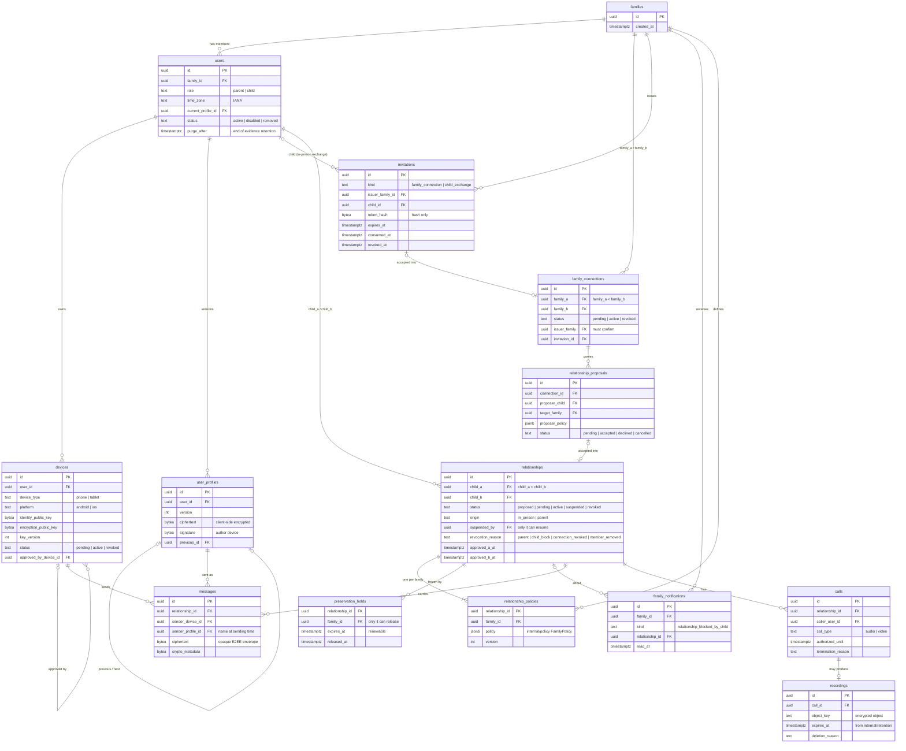

# Data Model

## Status
Draft — v0.1 — schema in `server/internal/store/migrations/`

## Principles

- **Random identifiers.** Every primary key is a random UUID. No username, phone number or e-mail is stored, and nothing is publicly enumerable.
- **No secret material.** Devices store public keys only. Private keys never leave the device.
- **No plaintext content.** Messages are opaque ciphertext envelopes; content type and attachment references are inside the ciphertext. User profiles (display names, avatars) are encrypted client-side, as immutable signed versions (see [protocol/profiles.md](../protocol/profiles.md)).
- **Database-enforced invariants.** Security-relevant rules are also enforced by constraints, so a bug in the application layer cannot create an invalid state.

## Entity-relationship diagram

## Invariants enforced by the database

| Table | Invariant |
|---|---|
| `user_profiles` | immutable: no update, no delete except with the user at purge; version 1 ⇔ no previous; one next per version; unique version per user |
| `users` | role is `parent` or `child`; `removed` ⇔ `removed_at` and `purge_after` set, with `purge_after` after `removed_at` |
| `devices` | `revoked` ⇔ `revoked_at` set; identity keys are unique |
| `family_connections` | one row per pair of families, canonical order `family_a < family_b`; the issuer is one of the pair; `active` requires `confirmed_at`; `revoked` ⇔ `revoked_at` |
| `invitations` | only the token hash is stored; `child_exchange` ⇔ a child **of the issuer family**; cannot be both consumed and revoked; finite expiry |
| `relationships` | each child belongs to the stated family; canonical order `child_a < child_b`; `active`/`suspended` require both parental approvals, `pending` exactly one, `proposed` none; children of different families; `suspended` ⇔ `suspended_by` set; `revoked` ⇔ a revocation reason; at most one non-revoked relationship per pair |
| `preservation_holds` | at most one unreleased hold per family and relationship; finite expiry |
| `relationship_proposals` | the proposed child belongs to the proposing family; proposer and target families differ; `accepted` requires the created relationship |
| `calls` | `authorized_until` (from the policy engine) is after the start; `ended_at` ⇔ `termination_reason` |
| `recordings` | one per call; `deleted_at` ⇔ `deletion_reason` |

## Metadata visible to the provider

Encryption does not hide metadata. With this schema, the provider can see:

- family membership (who is a parent or child of which family), and device counts and platforms;
- the relationship graph between children and between families;
- message timing, size and sender device per relationship;
- call timing, type, duration and termination reason;
- recording sizes and lifecycle dates.

The provider **cannot** see names, profile pictures, message content, attachment content or media. Reducing the metadata above (e.g. sealed sender, padding) is tracked as future work in the threat model.

## Authentication tables

`device_enrollments`, `auth_challenges` and `sessions` (migration `0002`) store only SHA-256 hashes of enrollment codes, nonces and session tokens. See [protocol/device-auth.md](../protocol/device-auth.md).

## Migrations

Migrations are plain SQL files embedded in the server binary (`NNNN_description.sql`). `store.Migrate` applies the pending ones, each in its own transaction, under a PostgreSQL advisory lock, so several instances can start at the same time.

Integration tests run when `TKC_TEST_DATABASE_URL` is set; each test uses a throw-away schema.
