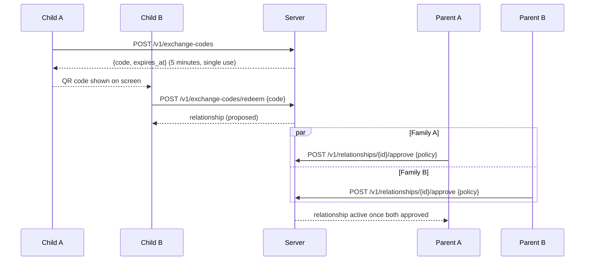
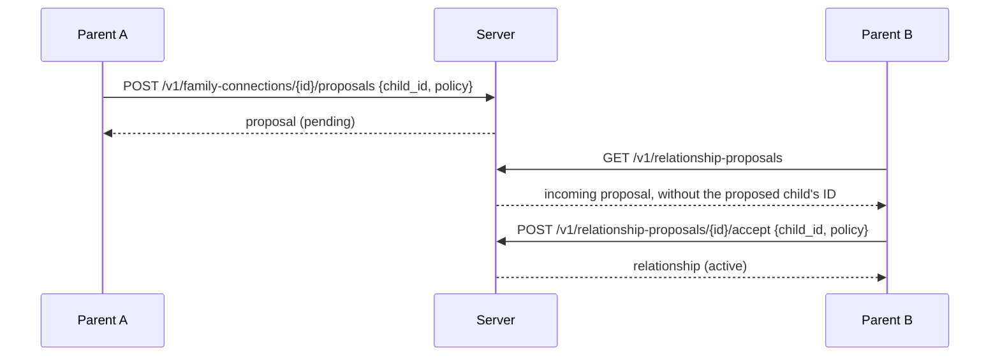
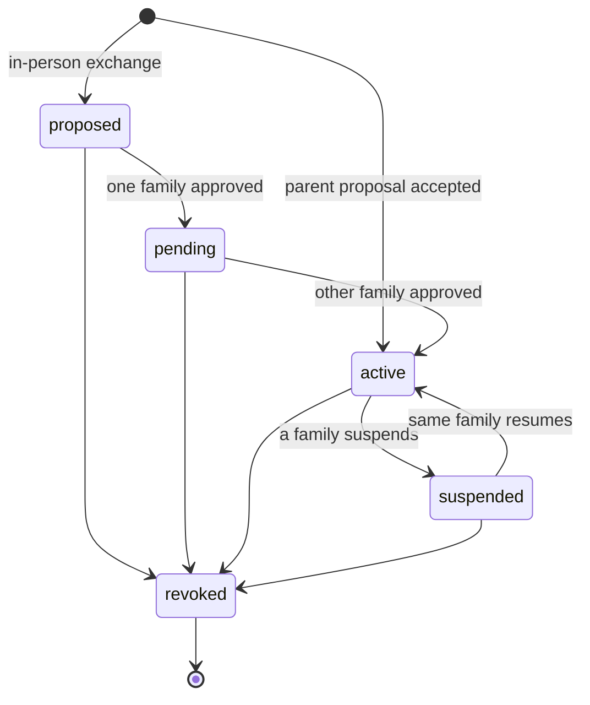

# Child Relationships

## Status
Draft — v0.1 — implemented in `server/internal/relationship`

## Principles

- A child-to-child relationship exists only through an **explicit trust path**: an in-person exchange approved by both families, or a parent proposal between two connected families.
- **No child is discoverable.** The server never discloses a child's ID to another family before both families agree to a relationship.
- **Each family sets its own policy** for the relationship when approving it. The effective policy is the intersection of the two (see [spec/relationship-policies.md](../spec/relationship-policies.md)). A family's raw policy is shown only to its own parents; the other side sees only the effective result.
- Members of the same family communicate by default without any relationship (see [spec/identity-family.md](../spec/identity-family.md)), so children of the same family are never linked through a relationship, and **a child cannot block their own family**.

## Path 1 — In-person exchange

- Only children create and redeem exchange codes; parents use the proposal path.
- Codes expire after 5 minutes and are single use. Only a hash is stored. Invalid, expired and used codes give the same `invalid_code` error.
- In-person relationships do not require a family connection.

## Path 2 — Parent proposal

Two families with an **active** [family connection](family-connections.md) can link their children without the children meeting.

- Parent A proposes **their own** child; parent B accepts by choosing **one of their own** children. Neither family has to know the other's child IDs in advance, so a connection does not reveal a family's children.
- Proposing and accepting are both families' approvals, so the relationship is created `active` with both policies.
- Who the proposed child is must be communicated between the parents (out of band for now; end-to-end encrypted profile sharing is future work, see ADR 0002).
- Either side can close a pending proposal (`POST /v1/relationship-proposals/{id}/close`): the target declines it, the proposer cancels it.

## Lifecycle

| Action | Who |
|---|---|
| Approve (with policy) | A parent of each family, once per family |
| Update policy | A parent of a family that already approved; applies immediately |
| Suspend | A parent of either family (active only) |
| Resume | A parent of the family that suspended it |
| Revoke / decline | A parent of either family, or **a child of the relationship (block)**, whose parents are then notified |

- **A child can block a relationship alone**, without waiting for their parents. The block takes effect immediately, and the child's parents receive a `relationship_blocked_by_child` notification so they can talk about it with the child. The other family sees that the relationship was blocked by the other child, but is not notified.
- Every revoked relationship records which family revoked it and why: `parent`, `child_block` or `connection_revoked`.
- Revocation is immediate and final: a revoked relationship never becomes active again. The children can start a new exchange later, which requires new approvals.
- **Revoking a family connection revokes every relationship between the children of the two families** (whatever their origin) and cancels pending proposals. Reconnecting does not restore them.
- **Starting over after a revocation.** Revoked relationships are kept as history for parents (status `revoked`, with the reason) but are never reactivated. The families and children can start again from zero, like new contacts:
  - the children can do a new in-person exchange at any time, even while the families are disconnected; it creates a new relationship that both families must approve again with new policies;
  - the families can reconnect with a new invitation and confirmation, after which parents can make new proposals.
  Nothing is carried over from the old relationships: no approval and no policy.
- Only `active` relationships allow communication. Messaging and signaling obtain the effective policy from `relationship.Service.Effective`, which fails for any other status or if a policy is missing.

## Visibility

- Parents see all relationships of their family, including revoked ones (history).
- Children see only their own relationships that are not revoked, and the effective policy, never a family's raw policy.
- The effective view includes the next 7 days of allowed call periods as absolute times, so parents can check how two families' schedules combine across time zones.

## HTTP API

| Method and path | Auth | Purpose |
|---|---|---|
| `POST /v1/exchange-codes` | child | Create an in-person exchange code |
| `POST /v1/exchange-codes/redeem` | child | Redeem another child's code `{code}` |
| `GET /v1/relationships` | member | List visible relationships |
| `GET /v1/relationships/{id}` | member | Relationship, own policy (parents) and effective policy |
| `POST /v1/relationships/{id}/approve` | parent | Approve `{policy}` |
| `PUT /v1/relationships/{id}/policy` | parent | Replace the family's policy `{policy}` |
| `POST /v1/relationships/{id}/suspend` | parent | Suspend |
| `POST /v1/relationships/{id}/resume` | parent | Resume (suspending family) |
| `POST /v1/relationships/{id}/revoke` | parent or child participant | Revoke, decline or block |
| `GET /v1/notifications` | parent | Family notifications, newest first (at most 100) |
| `POST /v1/notifications/{id}/read` | parent | Mark a notification as read for all parents of the family |
| `POST /v1/family-connections/{id}/proposals` | parent | Propose `{child_id, policy}` |
| `GET /v1/relationship-proposals` | parent | Pending proposals, incoming and outgoing |
| `POST /v1/relationship-proposals/{id}/accept` | parent (target) | Accept `{child_id, policy}` |
| `POST /v1/relationship-proposals/{id}/close` | parent (either) | Decline or cancel |

The `time_zone` of a submitted policy is ignored and replaced by the child's configured time zone.
