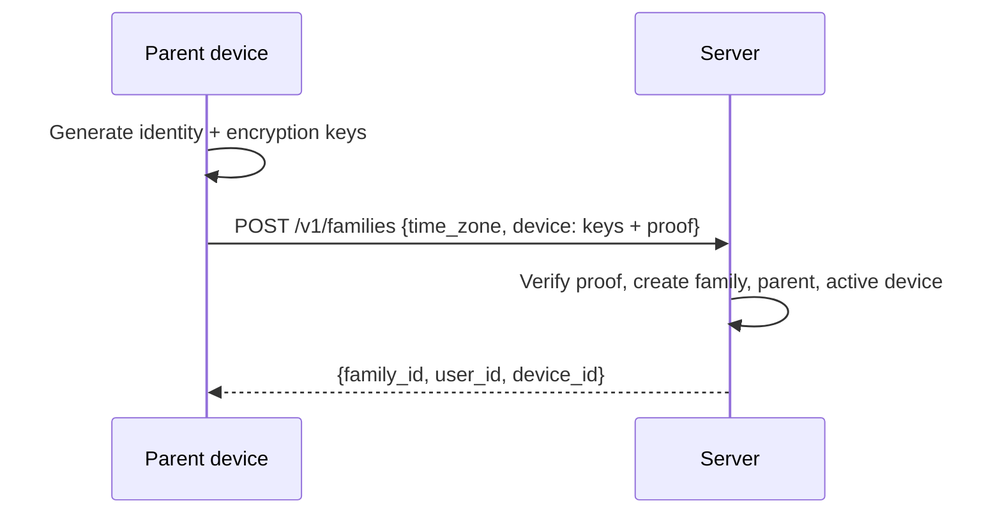
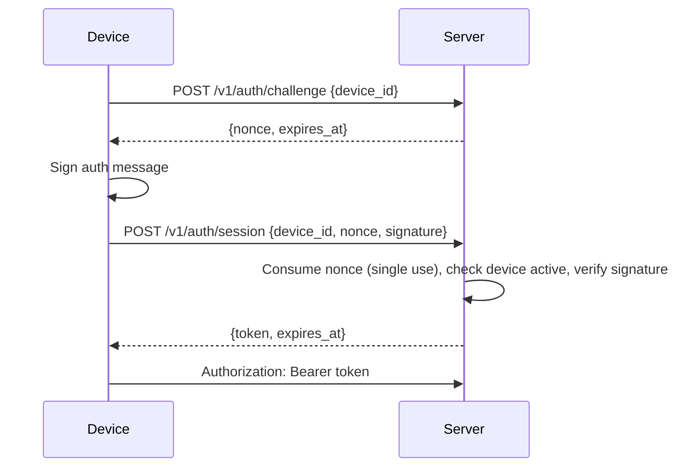
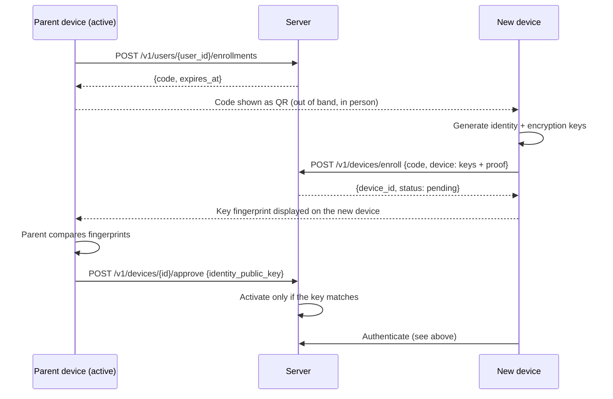
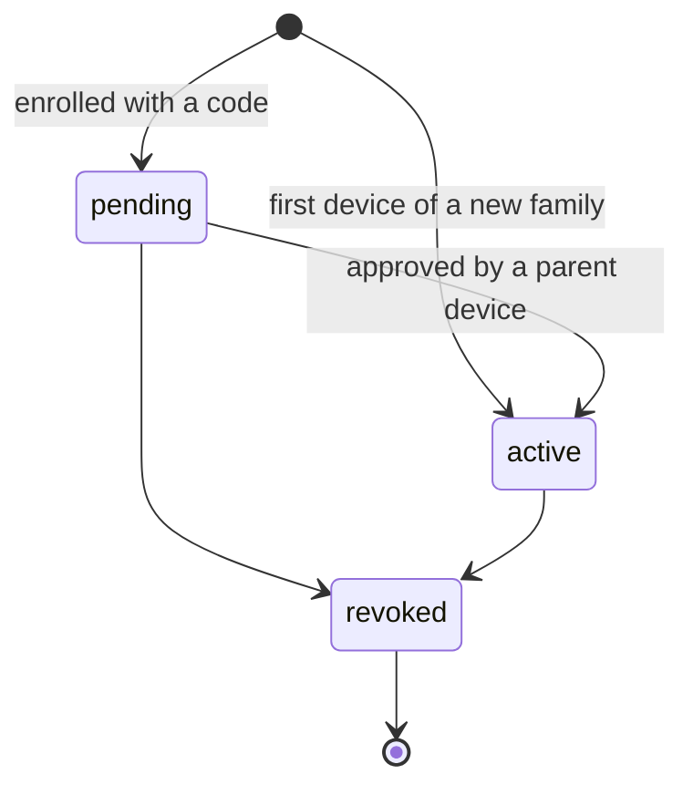

# Device Enrollment and Authentication

## Status
Draft — v0.1 — implemented in `server/internal/identity`

## Principles

- Every device has an **Ed25519 identity key pair** generated on the device. The private key never leaves it and should live in the platform keystore (Android Keystore, iOS Keychain/Secure Enclave where possible).
- The server stores **public keys only**. There are no passwords.
- A device authenticates by signing a **single-use challenge**.
- Apart from the very first device of a family, **every device starts `pending`** and becomes `active` only when an active **parent device** of the family approves it, after the parent has compared the new device's key fingerprint. Knowing an enrollment code is not enough.

The encryption public key is opaque to the server: its format will be fixed by the messaging protocol (see the E2EE research issue). It is bound to the identity key by a signature.

## Encodings

- Binary values in JSON (keys, signatures, nonces) are **standard base64**.
- Enrollment codes and session tokens are **base64url without padding**, encoding 32 random bytes.
- Device IDs are UUIDs in canonical text form; in signed messages they are encoded as their **16 raw bytes**.

## Signed messages

| Purpose | Message signed with the identity key |
|---|---|
| Key proof | `"tkc/v1/device-key-proof" ‖ 0x00 ‖ encryption_public_key` |
| Authentication | `"tkc/v1/auth-challenge" ‖ 0x00 ‖ device_id (16 bytes) ‖ nonce (32 bytes)` |

The prefixes separate domains so that one kind of signature can never be replayed as another.

## Creating a family

The first parent device is active immediately, because there is nobody to approve it.

## Authentication

- A nonce is returned for any well-formed device ID, so the endpoint does not reveal which devices exist; it is only usable for active devices.
- Nonces expire after 2 minutes and are consumed by the first attempt, successful or not.
- Sessions expire after 7 days. Revoking a device deletes its sessions immediately.
- The server stores only SHA-256 hashes of nonces, codes and tokens.

## Enrolling a new device

This flow covers a child's device, an additional device for a parent, and the first device of a new guardian (created with `POST /v1/users {role: "parent"}`).

- Codes are single use and expire after 15 minutes. Invalid, expired and used codes give the same error.
- A code becomes unusable if the parent device that issued it is revoked.
- The approving parent sends the key it compared; the server activates the device only if that key matches, so a device whose key was substituted after the comparison is not activated.

## Device states

- Parents may revoke any device of their family; other members may revoke only the device they are using.
- The **last active parent device cannot be revoked** until a family recovery process exists, otherwise the family would lose all administrative and cryptographic access.

## HTTP API summary

| Method and path | Auth | Purpose |
|---|---|---|
| `POST /v1/families` | — | Create a family and its first parent device |
| `POST /v1/auth/challenge` | — | Get a nonce |
| `POST /v1/auth/session` | — | Exchange a signed nonce for a session token |
| `POST /v1/auth/logout` | device | Delete the current session |
| `GET /v1/family` | device | Family members and all their device public keys |
| `POST /v1/users` | parent | Add a child or a guardian |
| `DELETE /v1/users/{id}` | parent | Remove a member and everything attached to it (refused if no active parent device would remain) |
| `POST /v1/users/{id}/enrollments` | parent | Issue an enrollment code |
| `POST /v1/devices/enroll` | — | Register a pending device with a code |
| `POST /v1/devices/{id}/approve` | parent | Approve a pending device |
| `POST /v1/devices/{id}/revoke` | parent or self | Revoke a device |

Errors are JSON `{"error": "<code>"}` with codes `invalid_request`, `unauthenticated`, `forbidden`, `not_found`, `invalid_code`, `conflict`, `key_mismatch`, `last_parent_device`, `internal_error`.

## Known limitations

- **No rate limiting yet** on unauthenticated endpoints.
- **The server is trusted to report device lists honestly.** A compromised server could insert a device into `GET /v1/family`. Detecting this (signed device lists, key transparency) belongs to the E2EE protocol work.
- **No recovery** if all parent devices are lost.
- Approving a parent device grants access to future content only once the messaging protocol distributes keys to it; access to historical content is a separate, explicit operation still to be specified.
