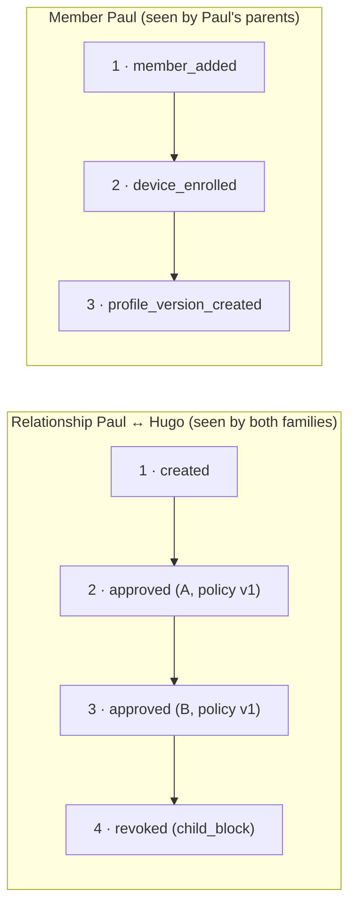

# Evidence Log

## Status
Draft — v0.1 — implemented in `server/internal/evidence` and migration `0010_evidence_log.sql`

## Purpose

Implements the event log and the integrity rules of [spec/evidence.md](../spec/evidence.md): the history of members, devices, connections, relationships and proposals is kept as it happened, cannot be altered or deleted before the end of the evidence retention period, and any tampering is detectable.

## Chains per subject

Events are hash-chained **per subject**, not per family:



- A relationship's timeline is **identical for both families**.
- At the end of the evidence retention period, purging a subject removes **its whole chain**; other chains are untouched and remain verifiable.

| Subject | Events | Visible to |
|---|---|---|
| `user` | `member_added`, `device_activated`, `device_enrolled`, `device_approved`, `device_revoked`, `profile_version_created`, `member_removed` | parents of the member's family |
| `relationship` | `relationship_created`, `relationship_approved`, `policy_updated`, `relationship_suspended`, `relationship_resumed`, `relationship_revoked` | parents of both families |
| `connection` | `connection_requested`, `connection_confirmed`, `connection_revoked` | parents of both families |
| `proposal` | `proposal_created`, `proposal_accepted`, `proposal_declined`, `proposal_cancelled` | parents of both families (with the connection) |

Each event records the time, the actor (user, device, and the actor's profile version at that time), the type, and data (before/after values, reasons, the family concerned). Cascades are recorded too: revoking a family connection records `relationship_revoked` (reason `connection_revoked`) in each affected relationship's chain.

### What is deliberately not in shared chains

- **Raw policies.** A family's policy is private; shared events only carry the **policy version number**. Each family keeps its own immutable policy versions (`relationship_policy_versions`), readable only by its parents.
- **Preservation holds.** Private to the family that sets them (see [spec/retention.md](../spec/retention.md#evidence-retention)).
- **The proposed child** in proposal events, which the target family must not learn before accepting. Both children appear in `relationship_created` once the proposal is accepted.

## Hash

```text
hash = SHA-256( prev_hash ‖ canonical_json(event) )
```

`canonical_json` is the JSON object with the fields, in this order: `subject_type`, `subject_id`, `seq`, `occurred_at` (RFC 3339, UTC, microseconds), `event_type`, `actor_user_id`, `actor_device_id`, `actor_profile_id`, `data` (compact JSON, keys sorted). `prev_hash` is empty for `seq = 1`. The `data` text is stored exactly as hashed.

Every timeline returned by the API includes `chain_valid`; clients can recompute the hashes themselves, which the evidence export (#24) will do on the parent's device.

## Database guards

| Table | Guard |
|---|---|
| `evidence_events` | no update; delete only once the subject has been purged |
| `relationship_policy_versions`, `user_profiles` | no update; delete only with their relationship or user |
| `users` | delete only if `removed`, past `purge_after`, and no active preservation hold on one of its relationships |
| `relationships` | delete only together with one of its children |
| `messages` | no update; delete only with their relationship or sender |

These rules hold even for a bug or a manual `DELETE`. The purge job passes its clock to the guards through the transaction setting `tkc.clock`; otherwise the database time is used.

A database superuser can still disable triggers; in that case the hash chains make altered or removed events detectable (tested).

## HTTP API

| Method and path | Auth | Purpose |
|---|---|---|
| `GET /v1/relationships/{id}/events` | parent of either family | Relationship timeline |
| `GET /v1/relationships/{id}/policy-versions` | parent | The family's own policy versions |
| `GET /v1/family-connections/{id}/events` | parent of either family | Connection and proposal timelines |
| `GET /v1/users/{id}/events` | parent of the member's family | Member timeline, also after removal |

Timelines are returned as `{events: [...], chain_valid: bool}`.

## Not yet logged

Invitation creation and revocation, enrollment codes, notifications and preservation holds are not in shared chains. Call and recording events will be added with calls (#12); recordings are not yet protected by a database guard because the recording retention job does not exist yet.
