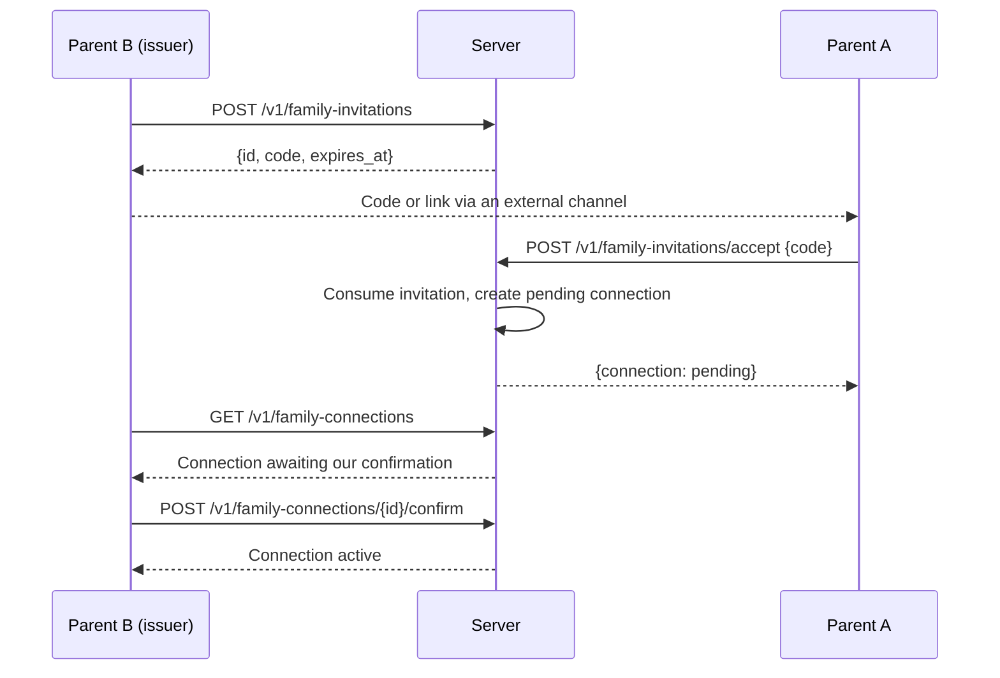
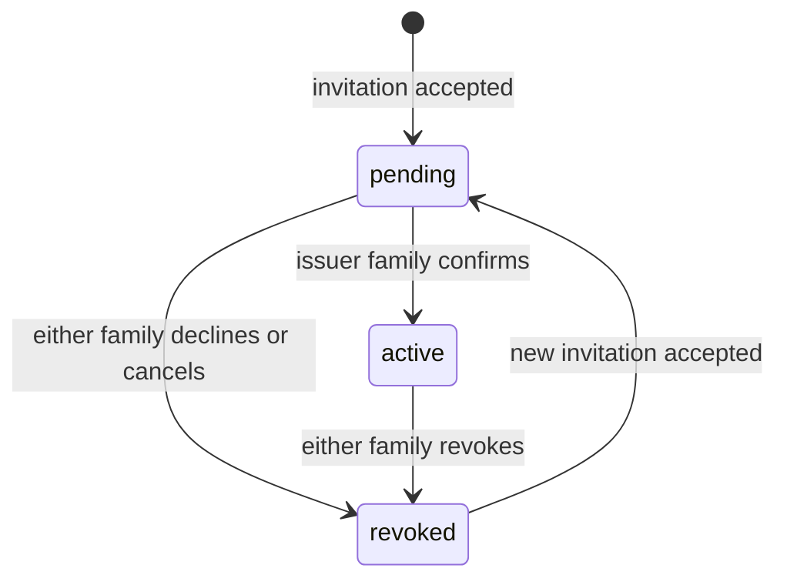

# Family Connections (parent-to-parent invitations)

## Status
Draft — v0.1 — implemented in `server/internal/relationship`

## Purpose

Two families connect so that their parents can later propose relationships between their children (see [spec/relationships.md](../spec/relationships.md)). The connection is established through a deliberate invitation sent over an external channel (SMS, e-mail, another messenger), without the families having to meet.

A family connection by itself grants **no communication** between children. It only establishes that the two families trust each other enough to propose child relationships.

## Flow

The issuer confirms after the acceptance so that a code intercepted on the external channel cannot silently connect an unknown family: parent B sees a pending connection appear and confirms only if it matches the family they invited (for example after checking with parent A through the same channel).

## Invitation properties

| Requirement (spec) | Implementation |
|---|---|
| High entropy | 32 random bytes, base64url (43 characters) |
| Time limited | Expires after 48 hours |
| Single use | Consumed atomically by the first acceptance; concurrent attempts get `invalid_code` |
| Revocable | `POST /v1/family-invitations/{id}/revoke` by the issuing family |
| No enumeration | Only a SHA-256 hash is stored; invalid, expired, used and revoked codes return the same `invalid_code` error; accepting requires an authenticated parent; nothing about the issuing family's members is revealed |

An invitation is also unusable if the parent who created it has been disabled. A family cannot accept its own invitation. If an acceptance fails (for example because the families are already connected), the code is not consumed.

## Connection states

- There is at most one connection per pair of families. Reconnecting after a revocation reuses it and requires a new invitation and a new confirmation; the new issuer may be either family.
- Only parents can manage connections. Children cannot see them.

## HTTP API

| Method and path | Auth | Purpose |
|---|---|---|
| `POST /v1/family-invitations` | parent | Create an invitation (the code is returned only here) |
| `GET /v1/family-invitations` | parent | List the family's invitations that can still be accepted (without codes) |
| `POST /v1/family-invitations/{id}/revoke` | parent (issuer) | Cancel an unused invitation |
| `POST /v1/family-invitations/accept` | parent | Accept another family's invitation `{code}` |
| `GET /v1/family-connections` | parent | List connections, with `awaiting_our_confirmation` |
| `POST /v1/family-connections/{id}/confirm` | parent (issuer) | Confirm a pending connection |
| `POST /v1/family-connections/{id}/revoke` | parent (either) | Decline, cancel or revoke |

## Open questions

- **Effect of revoking a family connection on existing child relationships.** Not decided yet; it will be specified with child relationships (#9). Options: revoke all relationships between the two families, or only those created through the parent path.
- **Identifying the other family.** Families have no name on the server (ADR 0002). Clients will need an end-to-end encrypted way to show parent B who accepted; until then, the out-of-band channel is the only confirmation.
