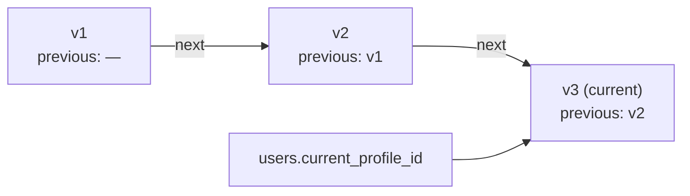

# Profiles

## Status
Draft — v0.1 — implemented in `server/internal/identity` (profiles.go)

## Principles

See [spec/evidence.md](../spec/evidence.md#versioned-profiles). In short:

- A profile (display name, avatar reference, other contact details) is **end-to-end encrypted** by the client; the server never sees a name (ADR 0002).
- A profile is **never modified**: every change appends a new **immutable, signed version** linked to the previous one.
- Messages record the sender's profile version at sending time (`messages.sender_profile_id`), so evidence shows the name in use when each message was sent.

## Versions



- Version 1 has no previous version; version *n* references version *n − 1*. The server returns both `previous_id` and `next_id`, so the chain can be followed from any version.
- A new version must name the **current** version as `previous_id`; otherwise the server answers `409 conflict`. Two concurrent edits therefore never silently overwrite each other.
- The author is the calling device: the user themself, or a **parent** of the user's family. Other members cannot edit someone else's profile.
- The encrypted profile is limited to 16 KiB; media such as avatars are stored separately and referenced.
- The database rejects any update of a version, and any deletion other than with the user itself, at the purge that ends the evidence retention period.
- A removed member's profile versions are kept as evidence; no new version can be added.

## Signature

The author device signs, with its Ed25519 identity key:

```text
"tkc/v1/profile" ‖ 0x00 ‖ user_id (16 bytes) ‖ version (uint32, big-endian)
  ‖ previous_id (16 bytes, zeros for version 1) ‖ ciphertext
```

Binding the user, the version number and the previous version prevents a version from being replayed for another user or moved within the chain. The server verifies the signature with the author device's key before storing the version; clients can verify it again at any time from the stored `signature` and the device's public key.

## Visibility

| Who | Current profile | Full history (evidence) |
|---|---|---|
| Members of the same family | yes (`GET /v1/family`) | parents only |
| The other family of a relationship, any status | yes, in relationship views | parents only, **even after revocation or removal** |
| Anyone else | no | no |

## Encryption

The format of the ciphertext and the keys it is encrypted for (the family's members and the other families of the user's relationships) depend on the end-to-end encryption protocol (#10). Until then, the server treats it as opaque bytes.

## HTTP API

| Method and path | Auth | Purpose |
|---|---|---|
| `POST /v1/users/{id}/profiles` | the user, or a parent of their family | Append a version `{previous_id, ciphertext, signature}` |
| `GET /v1/users/{id}/profiles` | parent with visibility | All versions, oldest first |

`GET /v1/family` returns each member's current version as `profile`; relationship views return `our_child_profile` and `other_child_profile`.
