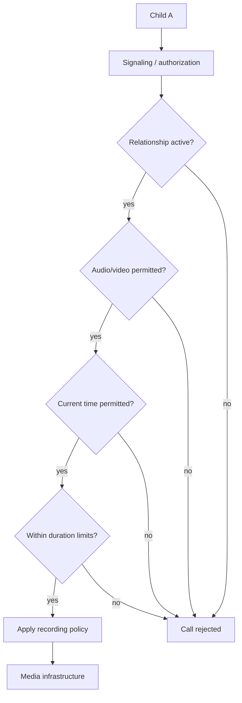
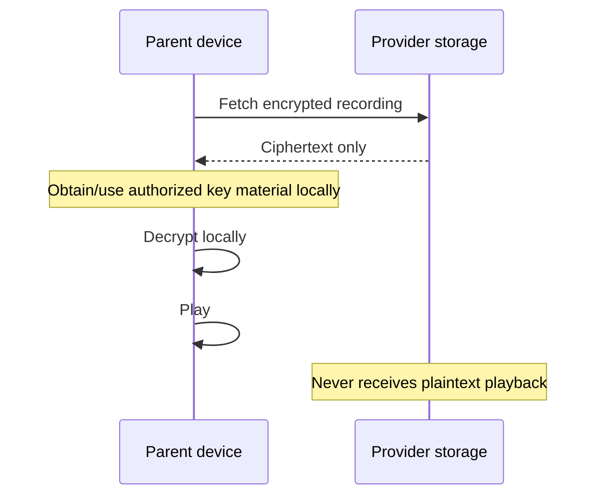

# Audio/Video Calls and Recording

## Objectives

The platform supports controlled audio and video communication between authorized children.

Parents may configure whether a relationship allows:

- no calls;
- audio only;
- audio and video;
- calls only during selected hours;
- maximum call durations.

The platform keeps call metadata and may retain encrypted call recordings according to parental policy and system retention rules.

## Call metadata

Metadata may include:

```text
call_id
relationship_id
participants
call_type
started_at
ended_at
duration
termination_reason
recording_status
```

Call metadata and call content have separate retention policies.

## Policy enforcement

Before establishing a call, the service verifies the effective relationship policy.



Restrictions must not rely exclusively on the Flutter client.

## Media architecture

An SFU-based architecture is a likely candidate for audio/video calls.


The final choice of SFU is not made in v0.1.

## Recording security requirement

The service provider must not be able to view retained audio/video content.

This creates a significant architectural requirement because a conventional server-side recorder often needs access to decoded media.

The project must investigate designs in which:

1. media remains end-to-end encrypted through the SFU;
2. encrypted media suitable for later reconstruction is retained; and
3. authorized parent devices can later decrypt/reconstruct playback.

An alternative recorder that becomes a cryptographic participant would weaken the zero-access-provider model unless its keys and execution environment can be proven outside provider control. It is therefore not the preferred starting assumption.

## Playback

Authorized parents should be able to see call history and, while the recording remains retained, request playback.

Conceptually:



## Recording indicator

Because calls are retained for parental supervision, recording must not be hidden from participants. The child-facing interface should make the supervision model understandable and age appropriate.

## Open research item

E2EE-compatible recording is one of the highest-risk technical areas in the project and requires a dedicated protocol design and security review before implementation.
