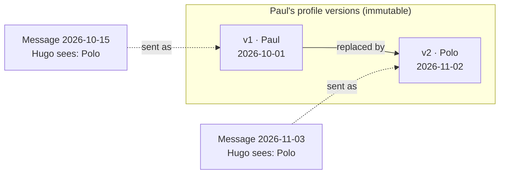

# Evidence

## Status
Draft — v0.1 — design; implementation tracked in GitHub issues

## Purpose

Communication involving minors may later be needed as **evidence**: legal proceedings, harassment, psychological follow-up. Evidence must be reliable for **both families** of a relationship, during the evidence retention period defined in [retention.md](retention.md#evidence-retention).

## Principles

1. **No anonymization.** Removing an account, revoking a relationship or blocking a contact never anonymizes or rewrites the history. Names and identities stay as they were.
2. **History is immutable.** What was said, by whom, under which name, and when, is never overwritten.
3. **Evolution is kept.** Changes over time — renames, approvals, policy changes, suspensions, revocations, device changes — are recorded as they happened, not only their latest state.
4. **Metadata matters.** Who did what, from which device, at what time, is kept alongside the encrypted content.
5. **The provider still cannot read content.** Names and messages remain end-to-end encrypted; evidence is readable only by the devices of authorized parents. The provider keeps ciphertext and metadata, and guarantees they are not altered or deleted before the end of the retention period.
6. Everything is purged at the end of the evidence retention period, not before.

## Versioned profiles

A user's profile (display name, avatar, and other contact details) is **never modified in place**. Every change creates a new, immutable **profile version** linked to the previous one.

- Each message records the **profile version of its sender at the time it was sent**.
- The normal interface shows the **current** profile everywhere, including on old messages, so conversations stay readable.
- The **evidence view** shows, for each message, the profile version that was current when it was sent, and the chain of versions.

Example: Hugo and Paul chat. Paul later renames himself Polo.

- In Hugo's conversation, every message shows **Polo** (current profile).
- In the evidence view, the message of 2026-10-15 shows it was sent by **Paul (v1)**, the message of 2026-11-03 by **Polo (v2)**, and that v1 and v2 are the same person.

### Properties

- A profile version is encrypted client-side (ADR 0002) for the members of the family and of the user's authorized relationships, and **signed by the device that created it**, so the provider cannot forge or alter a version unnoticed.
- Versions form a chain: each version references the previous one; the server keeps the link in both directions (previous → next) so the trace can be followed from any point.
- The server sees only metadata: which user, which version number, when, from which device.
- Versions are kept until the member is purged.

## Event log

Every security- or evidence-relevant change is appended to an **append-only event log**. Events are never updated or deleted, except by the purge at the end of the retention period.

Recorded events include:

| Area | Events |
|---|---|
| Family members | member added, member removed, profile version created |
| Devices | enrolled, approved (and by which device), revoked |
| Family connections | invitation created, accepted, confirmed, revoked |
| Relationships | created (and how), approved by a family, policy set or changed (with the policy version), suspended, resumed, revoked or blocked (with reason) |
| Proposals | proposed, accepted, declined, cancelled |

Each event records: time, family, actor user, actor device, actor profile version, subject (relationship, device, member…), event type, and the relevant before/after values. Policies are kept as **versions** rather than overwritten, so the rules in force at any past time can be reconstructed.

### Integrity

- The database rejects updates and deletes on the event log and on profile versions (only the retention purge may delete).
- Events are **hash-chained** per family: each event includes the hash of the previous one, so removing or altering an event breaks the chain and is detectable.
- Signed client-side elements (profile versions, and later messages) let a parent verify that content was produced by the claimed device.

## Visibility

- The parents of a family see the evidence of their family and of every relationship involving their children, including relationships with children of other families. Both families of a relationship therefore see the same history.
- Children do not see the evidence view.
- An **evidence export** for parents (events, profile versions and ciphertext, decrypted and verified locally on a parent's device) is planned, for handing over to a lawyer or an authority.

## Relation to other documents

- [retention.md](retention.md#evidence-retention): how long evidence is kept, and the open points (recordings hold, message retention, erasure requests).
- [identity-family.md](identity-family.md#removing-a-member): removing a member keeps its evidence until purge.
- [messaging-cryptography.md](messaging-cryptography.md): messages must reference the sender's profile version and be signed, so the evidence model holds once E2EE is designed.
