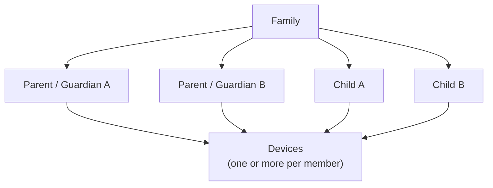

# Identity and Family Model

## Entities

### Family

A Family is the primary administrative trust domain.

A family may contain one or more authorized guardians. The design must not assume a single-parent or two-parent household.

### User

A user has a stable internal identity and a role such as:

- `parent`
- `child`

Publicly enumerable usernames are not required.

### Device

Cryptographic identity is associated with devices as well as users.

A device record should include at least:

- device ID;
- owner ID;
- device type;
- public identity/encryption keys;
- registration date;
- last-seen metadata;
- status: active/revoked;
- key version.

Private keys remain on authorized devices and should use platform secure-storage facilities where feasible.

## Parent devices

Parent devices are authorized to receive key material required to decrypt communications involving children under their supervision.

Adding a new parent device must therefore be treated as a security-sensitive operation.

Possible authorization mechanisms include:

- approval from an existing parent device;
- recovery material held by the parent;
- another strong family recovery process.

A normal account password alone should not silently grant historical decryption capability.

## Child devices

Child devices receive only the keys and capabilities necessary for the child's authorized relationships.

A lost or replaced device must be revocable.

## Family changes

The model must eventually cover:

- additional guardians;
- guardian removal;
- separated/divorced parents;
- loss of a parent device;
- child device replacement;
- family recovery;
- transfer of administrative authority;
- child reaching an age at which the account model changes.

These cases require explicit key-management semantics and must not be left as UI-only account operations.
