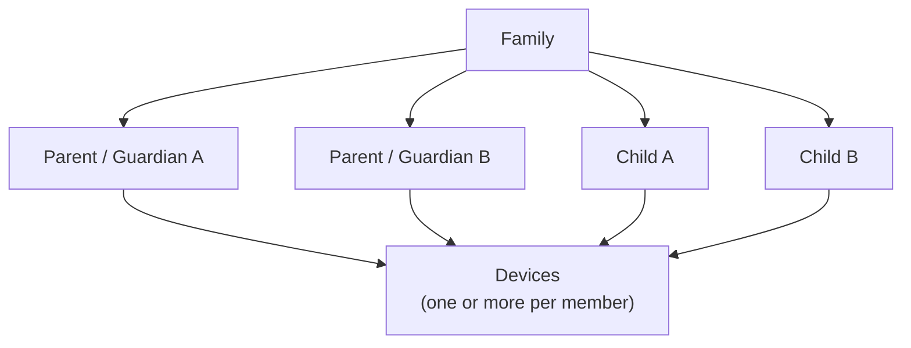

# Identity and Family Model

## Entities

### Family

A Family is the primary administrative trust domain.

A family may contain one or more authorized guardians. The design must not assume a single-parent or two-parent household.

### User

A user has a stable internal identity and a role such as:

- `parent`
- `child`

Publicly enumerable usernames are not required.

### Device

Cryptographic identity is associated with devices as well as users.

A device record should include at least:

- device ID;
- owner ID;
- device type;
- public identity/encryption keys;
- registration date;
- last-seen metadata;
- status: active/revoked;
- key version.

Private keys remain on authorized devices and should use platform secure-storage facilities where feasible.

## Parent devices

Parent devices are authorized to receive key material required to decrypt communications involving children under their supervision.

Adding a new parent device must therefore be treated as a security-sensitive operation.

Possible authorization mechanisms include:

- approval from an existing parent device;
- recovery material held by the parent;
- another strong family recovery process.

A normal account password alone should not silently grant historical decryption capability.

The enrollment, approval and authentication protocol is specified in [protocol/device-auth.md](../protocol/device-auth.md).

## Child devices

Child devices receive only the keys and capabilities necessary for the child's authorized relationships.

A lost or replaced device must be revocable.

## Communication within a family

Members of the same family — parents, guardians and children — can always communicate with each other. This needs no relationship, approval or policy: being in the family is the trust path.

Consequences:

- children of the same family are never linked through a child relationship;
- **a child cannot block their own family**: blocking applies only to relationships with children of other families;
- to stop a member from being visible and reachable within the family, a parent **removes the member's account** (see below).

## Removing a member

A parent can remove any member of their family, including another guardian or themselves (`DELETE /v1/users/{id}`). Removal happens in two stages:

1. **Immediately**, the member is retired: hidden from the family, all devices revoked and sessions ended, pending enrollment codes and invitations cancelled, relationships with children of other families revoked (reason `member_removed`) and pending proposals cancelled. The member can no longer communicate or be reached.
2. **Data is kept as evidence** — relationships, messages, calls and their metadata — for both families during the evidence retention period (see [retention.md](retention.md#evidence-retention)), then purged permanently.

A removal that would leave the family without any active parent device is refused, because no family recovery process exists yet.

Cryptographic consequence: once end-to-end encryption is designed, removing a member must rotate the keys of the family's conversations so that the removed member's devices cannot read future content.

## Family changes

The model must eventually cover:

- additional guardians;
- guardian removal;
- separated/divorced parents;
- loss of a parent device;
- child device replacement;
- family recovery;
- transfer of administrative authority;
- child reaching an age at which the account model changes.

These cases require explicit key-management semantics and must not be left as UI-only account operations.
