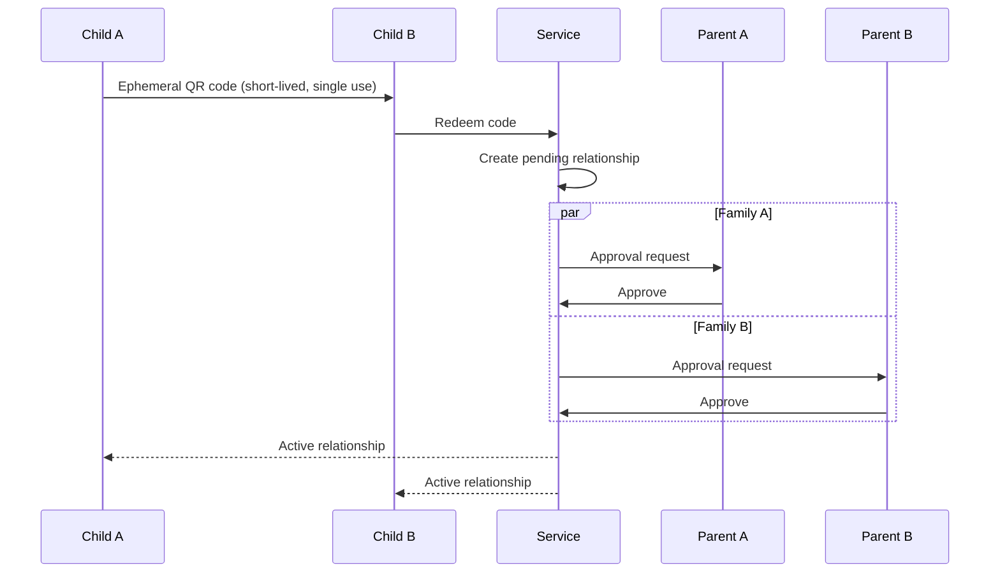
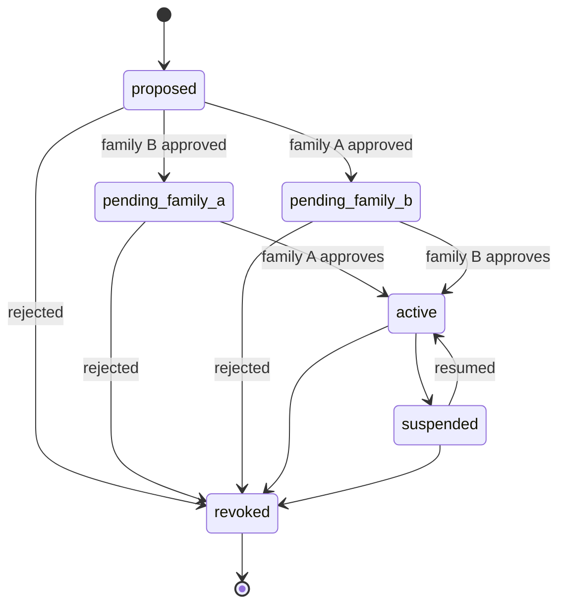

# Contacts and Relationships

## Principle

A child-to-child contact is an explicitly authorized relationship. There is no open contact-request mechanism for children.

## Relationship establishment paths

### In-person child exchange

Two children who are physically together may initiate a contact exchange using an ephemeral mechanism such as:

- QR code;
- NFC;
- Bluetooth-based proximity exchange.

Example:

The exchange token should be short-lived and single-use.

### Parent-to-parent connection

Parents may need to establish trust without meeting physically.

The protocol is specified in [protocol/family-connections.md](../protocol/family-connections.md).

A proposed mechanism is an out-of-band, deliberate invitation:

1. Parent B generates a temporary invitation.
2. The invitation is sent through an existing external channel such as SMS, email or another messenger.
3. Parent A opens or enters the invitation.
4. Parent B receives a confirmation request.
5. Both sides confirm the family connection.

The invitation should be:

- high entropy;
- time limited;
- single use;
- revocable;
- unusable to enumerate family or child identities.

### Parent-created child relationship

Once two families have established sufficient trust, parents may propose a relationship between specific children.

Both families can be required to approve it before activation.

## Relationship lifecycle

Suggested states:

Both approvals may occur in either order. Either family can reject a pending relationship, and a suspended relationship can be resumed.

In the database (`docs/data-model.md`), `pending_family_a` and `pending_family_b` are represented by the single status `pending` plus the per-family approval timestamps `approved_a_at` / `approved_b_at`.

## Revocation

The implemented protocol, including both establishment paths and the effect of revoking a family connection, is specified in [protocol/child-relationships.md](../protocol/child-relationships.md).

A relationship can be blocked or revoked.

Revocation must prevent future communication immediately at the authorization layer.

The cryptographic consequences of revocation — especially access to historical content — must be explicitly defined in the key-management specification.
